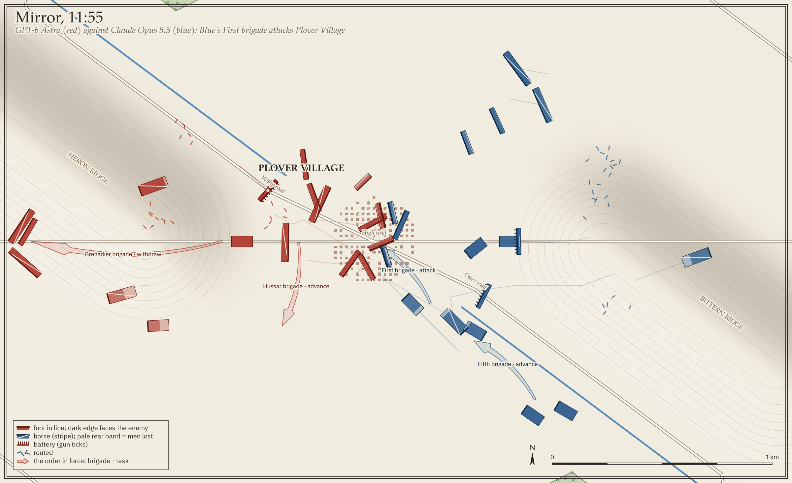
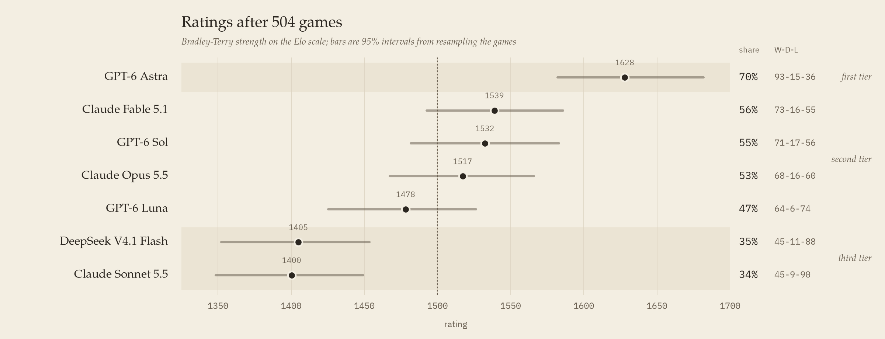

# General Bench

**Language models as generals in a free Kriegsspiel.**

Each model commands a horse-and-musket army of about 12,000 men. It writes its orders in
prose, as a general of 1800 would. A staff reads them into tasks and asks back when an order
is unclear. Couriers carry them across the field at a horse's pace, and a continuous engine
resolves marching, musketry, artillery, charges, morale and rout minute by minute. The general
sees only what its officers report. The battle ends when an army breaks.



Seven models played every other model from both sides on three battles, four seeds each:
**504 full games**.
Every brief, every order, every reading of an order and every verdict is in [`games/`](games/).

## Results

<picture>
  <source media="(prefers-color-scheme: dark)" srcset="docs/figures/standings-dark.png">
  
</picture>

| rank | model | W-D-L | share | 95% interval | rating | likely rank |
|---|---|---|---|---|---|---|
| 1 | GPT-6 Astra | 93-15-36 | 70% | 63 to 77% | 1628 | 1 |
| 2 | Claude Fable 5.1 | 73-16-55 | 56% | 49 to 64% | 1539 | 2 to 4 |
| 3 | GPT-6 Sol | 71-17-56 | 55% | 47 to 63% | 1532 | 2 to 4 |
| 4 | Claude Opus 5.5 | 68-16-60 | 53% | 45 to 60% | 1517 | 2 to 5 |
| 5 | GPT-6 Luna | 64-6-74 | 47% | 38 to 54% | 1478 | 3 to 5 |
| 6 | DeepSeek V4.1 Flash | 45-11-88 | 35% | 28 to 43% | 1405 | 6 to 7 |
| 7 | Claude Sonnet 5.5 | 45-9-90 | 34% | 27 to 42% | 1400 | 6 to 7 |

144 games per model. A draw counts half. The rating is a Bradley-Terry strength on the Elo
scale. Intervals and ranks come from resampling the games. Reproduce with
`uv run python scripts/standings.py`.

**Three tiers.** Astra is first in 99% of the resamples. Fable, Sol, Opus and Luna form the
middle; DeepSeek and Sonnet the bottom.

Head to head, rounds, replays, the noise floor and the seat balance: [`docs/results.md`](docs/results.md).

## Each model commands in its own way

The same brief, 144 games, and each model keeps a recognisable style. In depth, with one game
told for each: [`docs/generals.md`](docs/generals.md).

- **Astra rallies at once and gets its men back.** Its bodies break as often as anyone's, but 85%
  of its breaks get a rally order within a quarter hour (the others 38 to 72%), and it recovers
  52% of the men that broke (15 to 34%). It ends with 18% of its army broken, against 37 to 54%.
  > Pellow, withdraw to 1500 m west of Teasel Village, then rally the Fourth brigade there.
- **Fable fences its line and waits.** One order in eight carries a standing limit and one in
  five places a brigade by another; no other model passes 8% and 13%. It takes 61% on Plain and
  Mirror and 46% on Arms, where the armies differ.
  > Sixth brigade: advance to Bullace Farm and hold there in column behind the First brigade,
  > attacking nothing without further orders.
- **Sol plans once and lets it run.** 29% of its orders are written by 09:05 (the others 5 to
  27%), and an order to a formation stands a median 30 minutes before the next (the others 5 to
  25).
  > Royle attack Plover Village boldly, then hold Plover Village.
- **Opus garrisons the village.** At 09:00 it puts 2.3 brigades a game under orders "at all costs"
  (the others at most 1.4), and in 97% of its at-all-costs orders the phrase goes with "hold".
  > Second brigade will march at once in column by the High road, with all speed, to Teasel
  > Village, occupy it and hold it at all costs.
- **Luna attacks at once.** It opens with an attack in 56% of its games (the others 5 to 33%) and
  pays for it: 38% in those games, 58% in the rest. For the other six the opening makes no
  difference.
  > Sixth brigade advance in column to Teasel Village, deploy and attack any enemy there boldly.
- **DeepSeek re-sends everything.** An order to a brigade stands a median 5 minutes before the
  next (the others 18 to 30), and 57% repeat the task before (18 to 25%). A quarter of its orders
  hand a brigade a side or quarter of the village; no other model reaches 6%.
  > Fourth brigade (Bunce): hold the north side of Plover Village at all costs.
- **Sonnet goes quiet when it is hurt.** It gives no order at 40% of the briefs that report one
  of its bodies broken (the others 1 to 21%), and only 43% of its breaks get a rally order within
  half an hour (68 to 87%).
  > Mawhood, the Second brigade will fall back to Heron Ridge in good order and form in line on
  > the right of the Third brigade.

## The battles

Three battles on invented ground with invented names, so that no model can recall a historical
answer. Each changes one thing:

- **Plain**: open ground, identical armies, one crossroads village between them.
- **Mirror**: the same armies on ground that matters (brooks, fords, a ridge and a wood on each
  side), laid out so that each army sees the same field from its end.
- **Arms**: Plain's ground, armies of equal strength and different make-up: a horse army against
  a foot army.

Each army on Plain and Mirror has eleven formations of mixed quality, 12,440 men and 44 guns.
The day runs from 09:00 to 16:00, with up to two hours of play-on. Design and numbers:
[`docs/battles/`](docs/battles/README.md).

## How a game works

1. **Brief.** Both generals get the same text with the names swapped: the mission, the verdict
   rule word for word, a rules sheet with the engine's numbers, their own order of battle and
   the enemy's in outline. The opening brief runs to about 4,700 words.
2. **General.** One conversation per general per game, with no tools. It is consulted every
   fifteen battle minutes and when a report arrives, and the battle clock waits while it
   thinks. Every model plays at high reasoning effort, and we set no output cap.
3. **Staff.** A decisions model reads each order through fixed questions: who is addressed,
   which task, which objective and route, what to do on contact, when to start and stop. An
   order it cannot place goes back to the general as a question.
4. **Engine.** Movement, fire, melee, morale, rally, line of sight and couriers, one minute at
   a time, deterministic given the seed and the orders.
5. **Umpire.** It weighs each melee from a written account and scales the attacker by a factor
   between 0.7 and 1.4.
6. **Verdict.** An army with more than 40% of its men routed or destroyed for thirty minutes
   has lost. If neither breaks, whoever holds the village at 16:00 wins; if it is contested,
   play goes on by quarter hours for up to two hours, then it is a draw. 85% of the games were
   decided by a break.

The engine, the staff, the brief and the play loop: [`docs/engine.md`](docs/engine.md).

## Notes

- **One game is close to a coin flip**: replaying the same pairings gave the same winner in 15
  of 30. The standings rest on 144 games a model.
- **The staff and the harnesses are part of the instrument.** Every order is read by a model
  (Jev 1.14 in 450 games, GPT-6 Luna in 54), and each player runs in its own vendor's harness
  ([`docs/players.md`](docs/players.md)).
- **Fable helped build the engine**, and also plays.
- Rule changes between rounds, the seat balance and the engine fixes made after the matrix:
  [`docs/results.md`](docs/results.md), [`docs/engine.md`](docs/engine.md#changes-since-the-matrix).

## Running it

```sh
uv sync --group dev
uv run pytest                     # the test suite, about two minutes

# a scripted game: no model, no network
uv run python -m kriegsspiel.run --scenario data/plain-crossroads --mode stub

# a game between two models (the staff is Jev: AI_GATEWAY_API_KEY or OPENROUTER_API_KEY in .local/.env)
uv run python -m kriegsspiel.run --scenario data/plain-crossroads \
  --players red=opus,blue=sol --mode record

# replay a game bit for bit from its full run log
uv run python -m kriegsspiel.run replay runs/<game>/run.jsonl

# a round robin, then its standings
uv run python -m kriegsspiel.grid --scenario data/plain-crossroads \
  --round-robin opus,sol,luna --seeds 1 --out runs/my-grid
uv run python scripts/slim_games.py --out games/mine runs/my-grid
uv run python scripts/standings.py games/mine
```

Claude players need `claude` installed and logged in, GPT players `codex`. API players (DeepSeek)
read `DEEPSEEK_API_KEY` and need `--allow-api` on a grid. To add a model, add an entry to
`ROSTER` in [`src/kriegsspiel/players.py`](src/kriegsspiel/players.py).

## Game records

`games/round-1/` and `games/round-2/` hold the 504 matrix games, one gzipped JSON per game:
both generals' system prompts, every consultation with its brief and reply, every order as the
staff read it, every melee the umpire weighed, and the verdict. The format is described in
[`scripts/slim_games.py`](scripts/slim_games.py). `games/extra/` holds the noise-floor replays,
the DeepSeek rerun and the GPT-6 replays.

The full run logs are in the release
[`matrix`](https://github.com/onblueroses/general-bench/releases/tag/matrix); round 2 replays bit for
bit on that tag.

| script | what it prints |
|---|---|
| `scripts/standings.py` | standings, ratings, intervals, likely ranks, head to head, by round |
| `scripts/styles.py` | how each model commands: briefs, words, tasks, manners |
| `scripts/generals.py` | each model's command in depth, the numbers of [`docs/generals.md`](docs/generals.md) |
| `scripts/checks.py` | how battles end, seats, the noise floor, the replays, the DeepSeek rerun |
| `scripts/figures.py` | the figures above (`uv run --group figures`); the map replays a full run log, on the tag `matrix` |

## Repository

| path | what |
|---|---|
| `src/kriegsspiel/` | the engine, staff, umpire, narrator, verdict, players and grid runner |
| `data/` | the three battles: `plain-crossroads`, `mirror-fords`, `arms-medlar` |
| `games/` | the published game records |
| `docs/` | the engine, the battles, the players, the staff study, the results |
| `scripts/` | the analysis scripts above and the record slimmer |
| `tests/` | the test suite, with two test-only packs (Kolín 1757 and a flat test field) |

MIT licence. The game records and documents may be reused with attribution.
